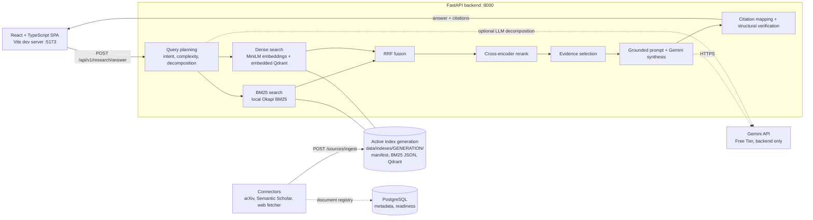

# AI Research Copilot

A local research-question-answering system. It retrieves evidence from an indexed paper corpus with hybrid search, reranks it with a neural cross-encoder, and has Gemini write an answer in which **every claim links back to the passage it cites** — all inspectable in a React UI.

> **Status: portfolio-grade prototype, not production-ready.** Validated end to end on a deliberately small corpus (41 documents). Citation verification is *structural*, not semantic. There is no authentication, no rate limiting, no load testing and no production deployment. See [Known limitations](#known-limitations).

---

## Core capabilities

- **Query planning:** intent and complexity classification, plus decomposition of complex questions into sub-questions.
- **Hybrid retrieval:** local Okapi BM25 and dense MiniLM embeddings, fused with Reciprocal Rank Fusion.
- **Neural reranking:** a cross-encoder reorders the top candidates; evidence selection de-duplicates and caps passages per document.
- **Grounded synthesis:** Gemini (Free Tier) answers only from the retrieved passages and returns structured JSON with evidence ids.
- **Citation inspection:** claim → citation → passage → source link, with ranking scores, in the UI.
- **Index integrity:** versioned index *generations* with manifests; incompatible or missing indexes fail closed instead of silently degrading.
- **Source connectors:** arXiv, Semantic Scholar and a web-page fetcher with SSRF protections.
- **Reproducible evaluation:** benchmark datasets, metric code, paired bootstrap comparisons and committed reports.

## Architecture



**What the diagram does not show, deliberately:** OpenSearch, a Qdrant server and Redis are **not required** by the intended local setup. BM25 and the vector index are local files. The code can try a remote OpenSearch/Qdrant first and falls back to the local stores; Redis is only probed (informationally) by `/ready`.

| Component | Role in the current implementation |
|---|---|
| **PostgreSQL** | Application metadata (document registry written by ingest endpoints, Alembic migrations) and a required `/ready` check. The research-answer path itself does not query it. |
| **Local BM25 store** | Own Okapi-BM25 over a JSON file inside the active index generation (title/abstract boosted). |
| **Embedded Qdrant** | `qdrant-client` in local-path mode; one collection per generation, cosine similarity. |
| **`all-MiniLM-L6-v2`** | 384-d normalized sentence embeddings for chunks and queries (local, sentence-transformers). |
| **`cross-encoder/ms-marco-MiniLM-L-6-v2`** | Neural reranker over the fused top-25 candidates (CPU). |
| **Gemini Free Tier** | The only intended real cloud LLM: answer synthesis and, in `auto`/`llm` decomposition mode, optional query decomposition. The key stays in the backend `.env`; it never belongs in frontend configuration. `LLM_PROVIDER=mock` gives a deterministic offline stand-in that the UI labels as a mock. |

**Design points:**
- **Index integrity.** Each generation has a manifest (embedding provider, model, revision, dimension, chunking, counts). Reads and writes validate model identity, not just dimension; missing, stale or incompatible indexes return HTTP 503. Mock embeddings exist only with `EMBEDDING_PROVIDER=mock`.
- **Canonical data root.** `DATA_DIR` (default `<repo>/data`) is independent of the working directory.
- **Honest errors.** Stable `{error, code, request_id}` bodies; provider quota, timeout and model errors are classified; details appear only in redacted logs.
- **SSRF protections.** Per-hop URL validation, IP pinning, scheme restrictions and a streaming size cap in the web fetcher. These are tested with mocked network; they are not a claim of complete security.

## Research workflow

1. **Plan** — classify intent/complexity; decompose complex questions into sub-questions.
2. **Retrieve** — each (sub-)question runs BM25 and dense search.
3. **Fuse** — Reciprocal Rank Fusion (k=60, α=0.5) merges the two rankings.
4. **Rerank** — the cross-encoder reorders the top-25 fused candidates.
5. **Select evidence** — de-duplicate near-identical passages, limit passages per document, merge across sub-questions.
6. **Synthesize** — Gemini writes a structured answer that cites evidence ids.
7. **Verify** — each claim's evidence ids are checked against the retrieved set (structural check only).
8. **Inspect** — click a citation to read the exact passage, its source link and ranking score; “Cited by” jumps back to the claims.

## Technology stack

| Layer | Technology |
|---|---|
| Backend | Python 3.12, FastAPI, Pydantic v2 / pydantic-settings, SQLAlchemy 2 (async) + asyncpg, Alembic, structlog, httpx |
| Retrieval and ranking | Local Okapi BM25, `qdrant-client` (embedded), sentence-transformers, PyTorch (CPU) |
| LLM | Google Gemini Free Tier (`google-generativeai`); mock provider for offline use |
| Frontend | React 19, TypeScript, Vite, Tailwind CSS 3, react-markdown, Vitest |
| Data | PostgreSQL (metadata); JSON corpus and benchmark files; local index generations |
| Testing | pytest (+ opt-in real-model tests), Vitest, `tsc` |

## Project structure

```
.
├── backend/
│   ├── main.py            FastAPI app factory
│   ├── api/v1/            health, research, retrieval, sources routers
│   ├── query/             intent, complexity, decomposition, planning
│   ├── retrieval/         BM25, dense, hybrid (RRF), chunking, index manifest + admin
│   ├── ranking/           cross-encoder reranker, evidence selection
│   ├── synthesis/         prompt building, answer service, citation mapping + verification
│   ├── llm/, embedding/   provider abstractions (Gemini / mock; MiniLM / mock)
│   ├── connectors/        arXiv, Semantic Scholar, SSRF-hardened web fetcher
│   ├── evaluation/        metrics and evaluators
│   ├── alembic/           database migrations
│   └── tests/             unit, API and integration tests
├── frontend/              React SPA (src/components, src/lib, src/api)
├── scripts/               index admin, corpus build, evaluation, validation, latency
├── data/
│   ├── corpus/            corpus.json (41 docs) and corpus_v1_7docs.json (original 7)
│   ├── evaluation/        retrieval and answer benchmark datasets
│   └── indexes/, backups/ local, git-ignored (generated or machine-specific)
├── docs/                  architecture, evaluation, demo, portfolio, design notes
├── reports/evaluation/    committed evaluation evidence (Phase 11 validation is the reference)
├── .env.example           configuration template (variable names only)
└── README.md
```

## Prerequisites

- **Windows PowerShell** (the commands below were verified on Windows 11; the code itself is not Windows-specific).
- **Python 3.12** and **Node.js 20+**.
- **PostgreSQL** running locally, with a database and user matching the `POSTGRES_*` values you put in `.env`.
- About **1 GB of disk** for PyTorch and model weights; the first index build downloads the MiniLM and cross-encoder weights from Hugging Face.
- A free **Gemini API key** from [Google AI Studio](https://aistudio.google.com) — optional if you run with `LLM_PROVIDER=mock`.

## Setup and run (Windows PowerShell)

From the repository root:

```powershell
# 1. Python environment
python -m venv .venv
.\.venv\Scripts\Activate.ps1
pip install -r backend/requirements-dev.txt

# 2. Configuration — copy the template, then edit .env (it is git-ignored)
Copy-Item .env.example .env
#    Set POSTGRES_* and GEMINI_API_KEY; keep EMBEDDING_PROVIDER=local.

# 3. Database schema (PostgreSQL must be reachable with the .env credentials)
cd backend
alembic upgrade head
cd ..

# 4. Build and verify the vector index from data/corpus/corpus.json
python scripts/index_admin.py rebuild
python scripts/index_admin.py verify

# 5. Start the backend  (http://localhost:8000, Swagger UI at /docs)
cd backend
python -m uvicorn main:app --port 8000
```

In a second terminal:

```powershell
cd frontend
npm install
npm run dev          # http://localhost:5173
```

Check that it works:

```powershell
Invoke-RestMethod http://localhost:8000/api/v1/health                    # liveness
Invoke-RestMethod http://localhost:8000/api/v1/ready                     # postgres + index + LLM config
Invoke-RestMethod http://localhost:8000/api/v1/retrieval/index/status    # active generation, model, counts
```

To run without a Gemini key, start the backend with `$env:LLM_PROVIDER = "mock"` first; the UI then labels answers as mock output. The first answer after launch is slow (about a minute measured) because models load lazily.

<details>
<summary>Troubleshooting</summary>

| Symptom | Likely cause / fix |
|---|---|
| UI shows “Can’t reach the backend” | Backend not running, or `VITE_API_BASE_URL` / `CORS_ORIGINS` mismatch |
| 503 `index_manifest_missing` | No index yet — run `python scripts/index_admin.py rebuild` |
| 503 `embedding_model_mismatch` | Index was built with a different model than configured — rebuild or revert `EMBEDDING_MODEL` |
| 503 `embedding_model_load_failed` | Model weights unavailable (offline on first run). Connect once to download them. Mock vectors are never substituted. |
| 429 `llm_rate_limited` | Gemini Free Tier quota or rate limit — wait and retry |
| 502 `llm_model_unavailable` | `GEMINI_MODEL` is not available to your key — change it in `.env` |
| 502 `llm_malformed_output` | Model output was truncated or invalid JSON — retry |
| `/ready` returns 503 | Read which required check failed (`postgres`, `index`, `llm`); OpenSearch/Qdrant/Redis are `skipped`, not required |

</details>

## Environment configuration

Variable names only — copy values from [`.env.example`](.env.example) and never commit `.env`.

| Variable | Purpose |
|---|---|
| `LLM_PROVIDER` | `gemini` (real) or `mock` (offline, deterministic, UI-labelled) |
| `GEMINI_API_KEY`, `GEMINI_MODEL` | Free Tier key and model id — **backend only**, never exposed to the browser |
| `LLM_ALLOW_PAID_PROVIDER` | Keep `false`; blocks OpenAI/Anthropic providers |
| `EMBEDDING_PROVIDER`, `EMBEDDING_MODEL` | `local` + `all-MiniLM-L6-v2`; `mock` is for tests only |
| `RERANKER_MODEL`, `RERANKER_DEVICE`, `RERANKER_FALLBACK_MODE` | Cross-encoder settings |
| `DATA_DIR` | Data root (default `<repo>/data`) |
| `POSTGRES_HOST`, `POSTGRES_PORT`, `POSTGRES_USER`, `POSTGRES_PASSWORD`, `POSTGRES_DB` | Metadata database |
| `CORS_ORIGINS` | Must include the frontend origin (default allows `:5173`) |
| `READINESS_PROBE_OPTIONAL` | Informational probe of unused OpenSearch / Qdrant server / Redis in `/ready` |
| `VITE_API_BASE_URL` | Optional, in `frontend/.env`: backend base URL including `/api/v1` (a template is in `frontend/.env.example`). Contains no secrets. |

## Corpus and index management

```
data/corpus/corpus.json            authoritative source documents (41); corpus_v1_7docs.json is the original 7
data/evaluation/*.json             benchmark datasets and relevance labels
data/indexes/ACTIVE                pointer to the active generation        (local, git-ignored)
data/indexes/gen-*/                manifest.json, bm25_index.json, qdrant/ (local, git-ignored)
data/backups/                      checksummed snapshots of pre-manifest stores (local, git-ignored)
```

```powershell
python scripts/index_admin.py status        # manifest + compatibility with the configured provider
python scripts/index_admin.py generations   # list generations
python scripts/index_admin.py rebuild       # new generation, verified, then activated atomically
python scripts/index_admin.py verify        # deep integrity check of the active generation
python scripts/index_admin.py prune         # remove generations that never completed
python scripts/build_expanded_corpus.py     # re-fetch the fixed arXiv distractor list via the connector
```

Rebuild after changing `EMBEDDING_MODEL`, chunk settings or the corpus. A failed rebuild leaves the previous generation active; older generations are kept until you remove them. Ingestion through `POST /api/v1/sources/ingest` adds to the *active* generation.

## Tests and evaluation

```powershell
# Backend (offline; needs cached model weights; about 3 minutes)
cd backend
python -m pytest -p no:cacheprovider -q
$env:RUN_REAL_MODEL_TESTS = "1"; python -m pytest -q tests/test_real_embeddings.py   # opt-in real models

# Frontend
cd ../frontend
npx tsc --noEmit; npm run build; npx vitest run

# Retrieval benchmark (real embeddings + neural reranker; no LLM) — run from the repository root
cd ..
python scripts/evaluate_system.py -v a,b,c,d --output reports/evaluation/repro
python scripts/verify_retrieval_paths.py

# One bounded real Gemini request (Free Tier; exits 2 if no key is configured)
python scripts/gemini_e2e_validate.py

# Latency of components (add --api <url> to time a running backend)
python scripts/measure_latency.py --components
```

## Measured results

Source of truth: [`reports/evaluation/phase11_final_validation.md`](reports/evaluation/phase11_final_validation.md) — final status **PASS WITH LIMITATIONS**.

| Check | Result |
|---|---|
| Backend tests | 325 passed, 0 failed, 4 skipped (opt-in real-model tests; 4/4 pass when enabled), 179.6 s |
| Frontend | `tsc` clean, production build OK, 10 unit tests pass |
| Security (focused, mocked network) | 93 tests passed: private/loopback/mapped-IPv6 redirects blocked, bad schemes rejected, oversized streams aborted, no secrets or paths in error bodies |
| Real Gemini, 1 request | PASS, 20.5 s, 5 evidence passages, 7 claims / 2 citations, structural verification 7/7 |

**Retrieval benchmark** — 25 queries over 41 documents / 41 chunks, real MiniLM vectors, neural reranker, original labels unchanged:

| Variant | R@1 | R@5 | R@10 | MRR | NDCG@5 | NDCG@10 |
|---|---|---|---|---|---|---|
| BM25 | 0.860 | 0.940 | 0.960 | 1.000 | 0.954 | 0.962 |
| Dense (MiniLM) | 0.760 | 0.980 | 0.980 | 0.933 | 0.925 | 0.925 |
| Hybrid (RRF) | 0.860 | 0.960 | 1.000 | 1.000 | 0.964 | 0.980 |
| Hybrid + rerank | 0.860 | 1.000 | 1.000 | 1.000 | 0.994 | 0.994 |

**Read this with the caveats.** The corpus is tiny (one chunk per document) and the relevance labels were written for the original 7 documents, so topically adjacent but unlabeled distractors count as misses. Paired bootstrap intervals on NDCG@10 mostly include zero (hybrid vs. dense +0.055, 95% CI [+0.002, +0.114]; rerank vs. hybrid +0.014, CI [0.000, +0.033], 3 wins / 0 losses / 22 ties). **The data do not establish that any method is better than another**; they show the pipeline is wired to real models and behaves sensibly.

**Latency** (CPU-only, 4 cores, tiny samples): cross-encoder over 25 candidates ≈ 4.6 s warm; API ≈ 4.2 s p50 warm with the mock LLM; real Gemini end to end 20.5 s (n=1); first request after start-up 57.8 s (n=1).

**Citation quality:** verification is a structural evidence-id check. One reviewer (not an independent human) read all 7 claims of one real answer against their cited passages and judged them supported; this is not an error-rate estimate.

## Known limitations

- **Citation verification is structural.** `SUPPORTED` means the cited evidence id is in the retrieved set; there is no entailment check. The summary paragraph is not claim-linked or verified.
- **Small, partially labeled corpus.** 41 abstract-level documents; labels cover 7; no human adjudication; no passage-level evaluation. Five sample-paper texts are project-authored summaries rather than verbatim abstracts.
- **Retrieval variants not re-benchmarked with a real LLM.** Decomposition and the full pipeline (variants E/F) were not evaluated beyond the single real run.
- **No relevance floor in evidence selection.** Low-scoring passages can still reach the LLM prompt.
- **Cold start and latency.** The first request loads models lazily (≈58 s measured); CPU reranking is slow; inference is serialized by a lock. No load or concurrency testing.
- **LLM quota.** With the default `DECOMPOSITION_MODE=auto`, a complex question can use two Gemini calls (decomposition + synthesis); mind the Free Tier quota. `deterministic` mode uses one.
- **Security is partial.** No authentication or rate limiting — run locally only. DNS rebinding is narrowed (connections are pinned to the validated IP), not proven eliminated; environment proxies are ignored in hardened mode; no dependency audit or fuzzing.
- **Not production-deployed.** No container image, CI/CD, monitoring or hosted deployment exists.
- **No research history.** Session tables exist but no API; the UI does not fake history.
- **Connectors.** Semantic Scholar and the web fetcher are unit-tested with mocked HTTP only; a GitHub connector flag exists but no connector is implemented.
- **Unused remote backends.** Remote OpenSearch/Qdrant code paths exist, are not governed by the index manifest and are not part of the intended setup; `opensearch-py` and `redis` remain in `requirements.txt`.
- **No visual or accessibility audit.** No screenshot/visual-regression testing or screen-reader audit was performed.

## Documentation

- [Architecture](docs/ARCHITECTURE.md) — original design document plus the implemented architecture and index-generation layout
- [Demo script](docs/DEMO.md) — 10-minute walkthrough
- [Portfolio summary](docs/PORTFOLIO.md) — defensible claims and claims not to make
- [Evaluation methodology](docs/EVALUATION.md) and [human evaluation protocol](docs/HUMAN_EVALUATION_PROTOCOL.md)
- [LLM synthesis and citations](docs/LLM_SYNTHESIS_AND_CITATIONS.md) · [Query intelligence](docs/QUERY_INTELLIGENCE.md) · [Reranking and evidence](docs/RERANKING_AND_EVIDENCE.md) · [Source connectors](docs/SOURCE_CONNECTORS.md)
- [Phase 11 validation report](reports/evaluation/phase11_final_validation.md) · [Phase 12 release report](reports/evaluation/phase12_portfolio_release.md)
- [Backend notes](backend/README.md) · [Project handover and audit log](docs/CLAUDE_CODE_HANDOVER.md)

## License

No license has been chosen yet. Until the owner adds a `LICENSE` file, all rights are reserved.
