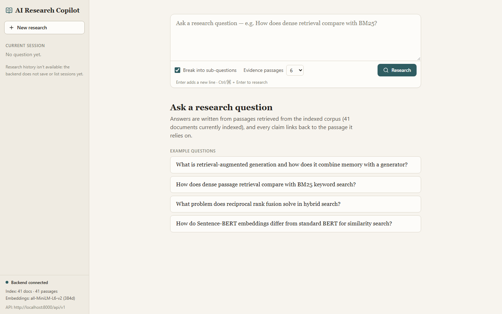
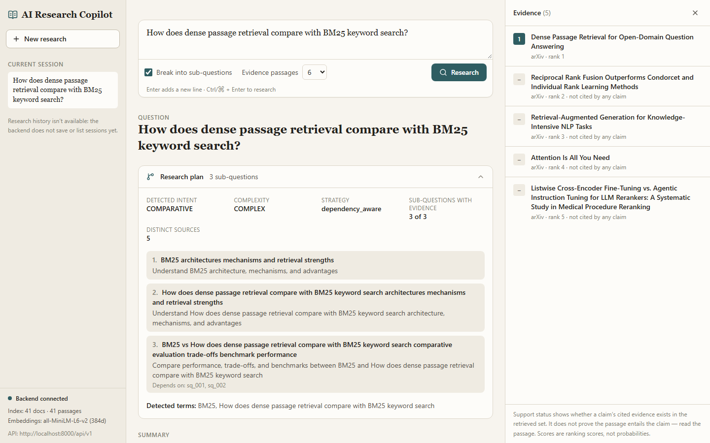
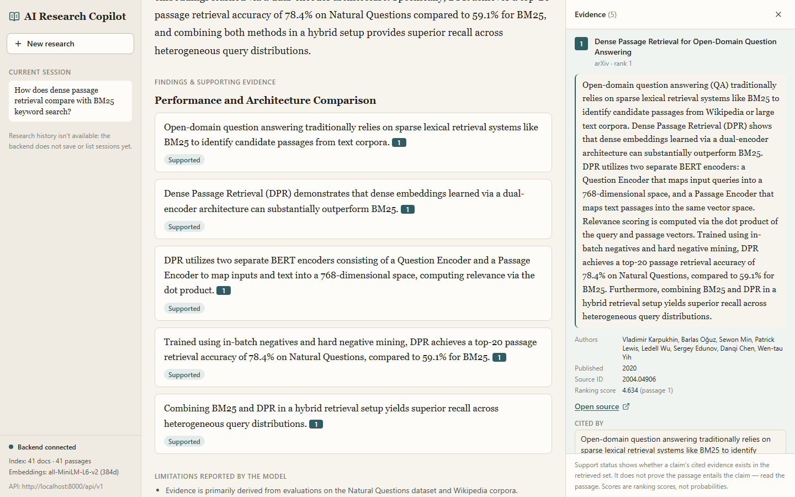
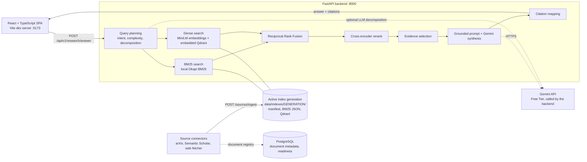

# AI Research Copilot

An AI-powered research assistant that combines hybrid information retrieval, neural reranking, and evidence-grounded language generation to produce research answers with inspectable citations.

Ask a research question and get a structured answer in which every claim links to the exact passage it was drawn from — with its source, ranking score and context one click away.

## Why it exists

Chat-style answers are hard to trust because you cannot see what they relied on. AI Research Copilot inverts that: it first *retrieves* evidence from an indexed paper corpus, then asks the language model to write only from those passages, and exposes the full chain **claim → citation → passage → source** in the interface. The reader checks the evidence instead of trusting the prose.

## Key features

**Research question planning**
- Intent and complexity classification for each question.
- Decomposition of complex questions into targeted sub-questions, rule-based or LLM-assisted.

**Hybrid retrieval**
- Lexical search with a local Okapi BM25 index (title and abstract boosted).
- Semantic search with `all-MiniLM-L6-v2` embeddings in an embedded Qdrant store.
- Reciprocal Rank Fusion to combine both rankings.

**Neural reranking and evidence selection**
- A `cross-encoder/ms-marco-MiniLM-L-6-v2` reranker reorders the fused candidates.
- Near-duplicate removal, per-document limits and merging across sub-questions produce a compact evidence set.

**Grounded answer synthesis**
- Gemini writes a structured JSON answer from the selected evidence only.
- Claims are mapped to evidence ids; each citation resolves to a retrieved passage with its source link and score.

**Index integrity**
- Indexes are versioned *generations*, each with a manifest recording embedding provider, model, revision, dimension, chunking and counts.
- Reads and writes validate model identity, not just vector size; a missing, stale or incompatible index fails with a clear error instead of degrading silently.
- Rebuilds are verified, then activated atomically; a failed rebuild leaves the previous generation serving.

**Research-source connectors**
- arXiv, Semantic Scholar and web-page fetching, with duplicate detection.
- The web fetcher validates every redirect hop, pins the connection to the validated address and caps response size.

**Interface**
- React and TypeScript single-page app with a research-plan panel, claims with citation chips, an evidence panel and “cited by” navigation back to claims.

## See it in action

The captures below come from the running application: a real Gemini answer over the bundled 41-document corpus.

**1. Ask a research question.** The sidebar shows the connected backend and the active index (documents, passages and embedding model).



**2. Inspect the research plan.** The question is classified and decomposed into sub-questions with their dependencies, and the evidence behind each is counted.



**3. Follow every claim to its evidence.** Each claim carries a citation chip and a status. Opening a citation shows the retrieved passage, its authors, source link and ranking score, and which claims cite it.



## Architecture



Search runs entirely on local files: BM25 and the vector index live in the active generation under `data/indexes/`. PostgreSQL stores document metadata and backs the readiness check; the answer path does not query it. Gemini is the only cloud service involved. No OpenSearch, Redis or Qdrant server is required.

## How the research pipeline works

1. **Plan.** The question is classified by intent and complexity; complex questions are decomposed into sub-questions.
2. **Retrieve.** Each (sub-)question runs BM25 and dense search against the active index generation.
3. **Fuse.** Reciprocal Rank Fusion (k = 60) merges the lexical and semantic rankings.
4. **Rerank.** The cross-encoder rescores the top 25 fused candidates.
5. **Select evidence.** Near-duplicates are dropped, passages per document are capped, and evidence from all sub-questions is merged.
6. **Synthesize.** Gemini receives only the selected passages and returns a structured answer with claims that cite evidence ids.
7. **Map citations.** Each claim's evidence ids are resolved against the retrieved evidence set, so every citation points to a passage that was actually retrieved.
8. **Inspect.** In the UI, a citation opens the passage with its source link and ranking score; “cited by” jumps back to the claims that rely on it.

## Technology stack

| Layer | Technology |
|---|---|
| Backend | Python 3.12, FastAPI, Pydantic v2, SQLAlchemy 2 (async) with asyncpg, Alembic, structlog, httpx |
| Retrieval | Local Okapi BM25, `qdrant-client` (embedded), sentence-transformers, PyTorch |
| Models | `all-MiniLM-L6-v2` (embeddings), `cross-encoder/ms-marco-MiniLM-L-6-v2` (reranking), Gemini Free Tier (generation) |
| Frontend | React 19, TypeScript, Vite, Tailwind CSS, react-markdown, Vitest |
| Persistence | Generation-based local index files, JSON corpus, PostgreSQL metadata |
| Quality | pytest, Vitest, `tsc`, reproducible benchmark scripts |

## Project structure

```
.
├── backend/
│   ├── main.py            FastAPI application
│   ├── api/v1/            health, research, retrieval and sources routers
│   ├── query/             intent, complexity, decomposition, planning
│   ├── retrieval/         BM25, dense, hybrid fusion, chunking, index manifests and admin
│   ├── ranking/           cross-encoder reranker, evidence selection
│   ├── synthesis/         prompting, answer service, citation mapping and checks
│   ├── llm/, embedding/   provider abstractions (Gemini, mock; MiniLM, mock)
│   ├── connectors/        arXiv, Semantic Scholar, web fetcher
│   ├── evaluation/        metrics and evaluators
│   ├── alembic/           database migrations
│   └── tests/
├── frontend/              React SPA (src/components, src/lib, src/api)
├── scripts/               index admin, corpus build, evaluation and validation tools
├── data/
│   ├── corpus/            source documents
│   └── evaluation/        benchmark datasets
├── docs/                  architecture, evaluation, demo and design notes
├── reports/evaluation/    evaluation reports
└── .env.example           configuration template
```

## Quick start (Windows PowerShell)

**Prerequisites:** Python 3.12, Node.js 20+, and a local PostgreSQL server with a database and user matching the `POSTGRES_*` values you set below. Plan for about 1 GB of disk for PyTorch and model weights (downloaded from Hugging Face on first use). A free [Gemini API key](https://aistudio.google.com) is needed for real answers; without one you can use the mock LLM.

From the repository root:

```powershell
# 1. Python environment and dependencies
python -m venv .venv
.\.venv\Scripts\Activate.ps1
pip install -r backend/requirements-dev.txt

# 2. Configuration: copy the template, then set POSTGRES_* and GEMINI_API_KEY in .env
Copy-Item .env.example .env

# 3. Database schema
cd backend
alembic upgrade head
cd ..

# 4. Build and verify the search index from data/corpus/corpus.json
python scripts/index_admin.py rebuild
python scripts/index_admin.py verify

# 5. Start the backend: http://localhost:8000 (Swagger UI at /docs)
cd backend
python -m uvicorn main:app --port 8000
```

In a second terminal:

```powershell
cd frontend
npm install
npm run dev          # http://localhost:5173
```

Confirm the backend is ready with `Invoke-RestMethod http://localhost:8000/api/v1/ready`, then open the UI and ask a question such as *“How does dense passage retrieval compare with BM25?”*

**Running without a Gemini key.** Start the backend with `$env:LLM_PROVIDER = "mock"` set. The mock provider is deterministic, runs offline and is clearly labelled in the UI as not a real model answer.

**First run.** Models load lazily, so the first answer after launch takes noticeably longer than later ones. A `503 index_manifest_missing` response means the index has not been built yet — run step 4.

## Environment configuration

Settings are read from the root `.env` (see [`.env.example`](.env.example) for every variable). The Gemini key is used by the backend only and never belongs in frontend configuration.

| Variable | Purpose |
|---|---|
| `LLM_PROVIDER` | `gemini` for real answers, `mock` for offline development |
| `GEMINI_API_KEY`, `GEMINI_MODEL` | Gemini Free Tier credentials and model id |
| `EMBEDDING_PROVIDER`, `EMBEDDING_MODEL` | Local sentence-transformers embeddings (`local`, `all-MiniLM-L6-v2`) |
| `RERANKER_MODEL`, `RERANKER_DEVICE` | Cross-encoder model and device |
| `DATA_DIR` | Data root for corpus and indexes (default `./data`) |
| `POSTGRES_HOST`, `POSTGRES_PORT`, `POSTGRES_USER`, `POSTGRES_PASSWORD`, `POSTGRES_DB` | Metadata database |
| `CORS_ORIGINS` | Allowed frontend origins (default includes `http://localhost:5173`) |
| `VITE_API_BASE_URL` | Optional, in `frontend/.env`: backend URL including `/api/v1` |

## Evaluation

The retrieval pipeline is benchmarked on 25 queries over a 41-document corpus with real embeddings and the neural reranker:

| Retrieval variant | NDCG@10 |
|---|---|
| BM25 | 0.962 |
| Dense retrieval (MiniLM) | 0.925 |
| Hybrid retrieval (RRF) | 0.980 |
| Hybrid retrieval + neural reranking | 0.994 |

The repository includes backend and frontend test suites and reproducible evaluation scripts (`scripts/evaluate_system.py`, `scripts/verify_retrieval_paths.py`). See the [full evaluation report](reports/evaluation/phase11_final_validation.md) for methodology, per-query comparisons and latency measurements.

## Notes

- **Citation checks are structural.** Verification confirms that each claim cites evidence that was retrieved; it does not assess whether a passage semantically entails the claim.
- **The benchmark corpus is small.** Relevance labels were written for the original seven documents, so the numbers above describe pipeline behavior on this corpus, not general search quality.
- **Gemini is configured on the backend.** Real answers need `GEMINI_API_KEY` in the backend `.env`.
- **The API is built for local use** and has no authentication layer.

## Documentation

- [Architecture](docs/ARCHITECTURE.md): design, data storage, index generations and runtime hardening
- [LLM synthesis and citations](docs/LLM_SYNTHESIS_AND_CITATIONS.md): prompting, citation mapping and checks
- [Evaluation methodology](docs/EVALUATION.md) and the [full evaluation report](reports/evaluation/phase11_final_validation.md)
- [Demo walkthrough](docs/DEMO.md)
- [Query intelligence](docs/QUERY_INTELLIGENCE.md) · [Reranking and evidence](docs/RERANKING_AND_EVIDENCE.md) · [Source connectors](docs/SOURCE_CONNECTORS.md)
- [Backend guide](backend/README.md)

## License

No license has been selected yet; all rights are reserved until a `LICENSE` file is added.
